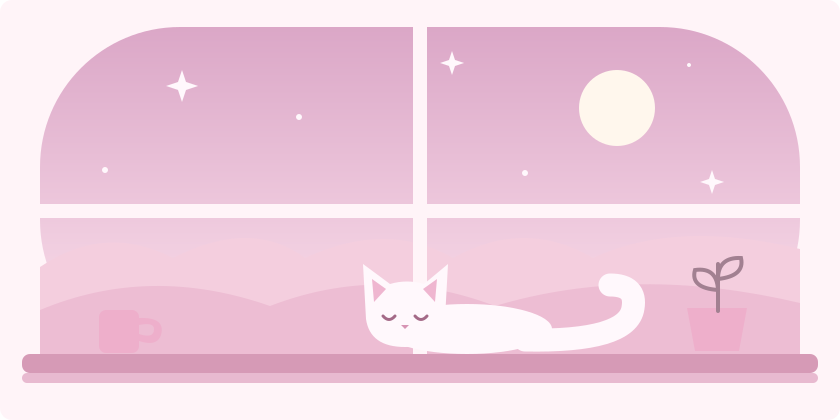

# hello hello ♡

ashley / akane · estudante de programação

 
 

`valorant` · `c#` · `rosa & branco`

 
 

---

### 🌸 sobre mim

**oi, eu sou a ashley — pode me chamar de akane.**

Estou estudando **C#** e gosto de jogar **Valorant**. 
Este é meu cantinho para compartilhar o que vou aprendendo ♡

 

 
entre um jogo e uma linha de código

 
 

---

### 🕹️ no meu radar

**agora:** estudando C# 
**próximos passos:** SQL e JavaScript 
aprendendo uma coisa de cada vez ♡

 
 

---

### 💻 estudos

**estudando** 
`C#`

**quero aprender** 
`SQL` · `JavaScript`

 
 

---

### 🎀 meu universo

🎮 Valorant entre uma sessão de estudos e outra 
💻 programação para aprender coisas novas 
🌷 um pouquinho de rosa em tudo

 
 

---

### 🌱 meu jardim no github

Cada aprendizado tem seu tempo para florescer.

[acompanhe meus projetos](https://github.com/akane4chaw?tab=repositories) · [minhas contribuições](https://github.com/akane4chaw#js-contribution-activity)

 
 

obrigada por passar por aqui ♡

 
 

